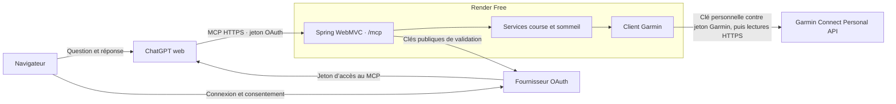

# Architecture du serveur Garmin MCP

## Paradigme

Un service Spring Boot déployé en un conteneur. Spring WebMVC expose les outils MCP, les services d’analyse calculent les résultats et le client Garmin lit l’API officielle. Garmin Connect reste la source des données. Spring transmet les agrégats et ChatGPT les présente.

## Règles d’architecture

### AD-1 — Un seul point d’entrée pour ChatGPT

- **Binds** · CAP-1, CAP-2, transport et dépendances.
- **Prevents** · La duplication des calculs et la perte d’une session MCP à chaque redémarrage.
- **Rule** · Exposer `/mcp` en Streamable HTTP sans état de session, via le starter WebMVC de Spring AI en mode `STATELESS`. Les adaptateurs MCP dépendent des services d’analyse, qui dépendent du client Garmin. Les types et réponses brutes de Garmin restent dans l’adaptateur Garmin. Le serveur exécute ses calculs localement. [Spring AI et MCP sans état](https://docs.spring.io/spring-ai/reference/api/mcp/mcp-stateless-server-boot-starter-docs.html)

### AD-2 — Authentifier le propriétaire avant tout accès Garmin

- **Binds** · Accès depuis ChatGPT web, Spring Security et opérations MCP.
- **Prevents** · L’accès au compte Garmin par un tiers, même avec un jeton valide pour une autre identité ou une autre ressource.
- **Rule** · Sélectionner le mode **OAuth** dans ChatGPT pour protéger l’ensemble du serveur. ChatGPT utilise le code d’autorisation avec PKCE `S256`. Les seuls points d’entrée publics sont `GET /health` et `GET /.well-known/oauth-protected-resource`. Les métadonnées déclarent l’URL HTTPS exacte de `/mcp` comme `resource` et l’issuer dans `authorization_servers`. Une requête sans jeton valide reçoit `401` et un en-tête `WWW-Authenticate: Bearer` dont le paramètre `resource_metadata` désigne cette URL de découverte. Spring Security valide la signature, l’émetteur, l’expiration et l’audience du jeton. L’audience attendue est l’URL MCP complète. Spring compare `sub` à l’identifiant stable du propriétaire dans cet issuer. Un autre sujet reçoit `403`. Ce contrôle protège tous les appels à `/mcp`. Sans configuration OAuth complète, le service bloque les appels MCP et les lectures Garmin. [Modes d’authentification de ChatGPT](https://developers.openai.com/api/docs/guides/custom-mcp-server) · [Découverte OAuth MCP](https://modelcontextprotocol.io/specification/2025-11-25/basic/authorization)
- La chaîne de sécurité MCP utilise uniquement le jeton Bearer, sans cookie ni session navigateur. Elle refuse par `403` un en-tête `Origin` présent et non autorisé. La configuration doit laisser un `POST /mcp` sans jeton atteindre le challenge OAuth. Une URL publique configurée, un issuer et un sujet autorisé propres à l’environnement servent de référence pour tous ces contrôles. [Transport Streamable HTTP](https://modelcontextprotocol.io/specification/2025-11-25/basic/transports)
- **[ASSUMPTION]** WorkOS AuthKit via CIMD pour le premier essai. Activer CIMD dans **Connect → Configuration** et déclarer l’URL MCP comme *Resource Indicator*. Demander `offline_access` pour permettre le renouvellement côté ChatGPT. Le droit métier vient de l’association de l’audience et du sujet autorisé. L’environnement de test AuthKit sert aux données fictives. L’environnement de production demande des informations de facturation, même pour l’usage compris dans le quota gratuit. [OAuth pour ChatGPT](https://developers.openai.com/plugins/build/auth) · [Spring Security JWT](https://docs.spring.io/spring-security/reference/servlet/oauth2/resource-server/jwt.html) · [AuthKit MCP](https://workos.com/docs/authkit/mcp) · [Conditions WorkOS](https://workos.com/docs/authkit/environments)

### AD-3 — Garder les identifiants Garmin côté Spring [ADOPTED]

- **Binds** · Client Garmin, configuration locale et Render.
- **Prevents** · Le mélange entre jetons OAuth de ChatGPT et Garmin et la divulgation de la clé personnelle.
- **Rule** · Spring lit la clé depuis `GARMIN_API_KEY` à l’exécution. Le client Garmin échange la clé via l’endpoint de jeton personnel et conserve le jeton en mémoire jusqu’à sa date d’expiration, 24 h au maximum. Il renouvelle le jeton à la demande. Les lectures de données sont des `GET` vers la Personal API. Une clé refusée produit une erreur d’accès exploitable. Les journaux, réponses, images Docker et artefacts Git excluent clés, jetons et données Garmin brutes. [Authentification Garmin](https://developer.garmin.com/gc-developer-program/personal/personal-faq/)

### AD-4 — Renvoyer des agrégats calculés par Spring [ADOPTED]

- **Binds** · CAP-1 et CAP-2.
- **Prevents** · Un total de course partiel, une nuit absente traitée comme zéro et un jour de repos déduit d’une panne.
- **Rule** · Les outils déclarent leur usage en lecture seule (`readOnlyHint`). Les périodes sont des dates civiles inclusives au format ISO. Le serveur rend explicites la période, l’unité et la disponibilité. Une erreur de lecture amont donne un résultat indisponible. Une nuit sans mesure après une lecture réussie compte parmi les nuits manquantes. Garmin conserve l’historique. Spring calcule à la demande et ne stocke aucune donnée métier.

| Capacité | Outil | Convention |
| --- | --- | --- |
| CAP-1 · Kilométrage hebdomadaire | `running_distance` | Lundi au dimanche précédents dans `Europe/Paris` par défaut. Utiliser la date locale Garmin de départ, la famille course et les pages complètes. Dédupliquer par identifiant Garmin et compter une distance une seule fois entre un parent et ses segments. Renvoyer les dates, le nombre de courses et les kilomètres. Zéro course donne 0 km après une lecture complète. |
| CAP-2 · Comparaison du sommeil | `compare_sleep_by_training_day` | Prendre par défaut les 28 derniers jours terminés et rattacher chaque nuit au jour précédant le réveil. Une journée avec au moins une séance Garmin, marche comprise, compte une fois comme entraînement. Les pas seuls ne constituent pas une séance. Renvoyer les moyennes du sommeil principal hors siestes et les nombres de nuits mesurées ou manquantes. Calculer l’écart dans le sens entraînement moins repos quand les deux groupes sont mesurés. |

[Swagger de la Garmin Connect Personal API](https://developer.garmin.com/gc-developer-program/personal/swagger-docs/)

### AD-5 — Un service Render Free

- **Binds** · Construction de l’image, réseau et exploitation.
- **Prevents** · La dépendance au Mac, l’import du secret pendant le build et l’exposition des données via un contrôle de disponibilité.
- **Rule** · Déployer un *Web Service* Free à partir de `main` avec un Dockerfile à la racine. Écouter sur `0.0.0.0` et sur le `PORT` fourni par Render. Utiliser le HTTPS de l’URL `onrender.com`. Le contrôle `GET /health` indique uniquement que le processus répond, sans appeler Garmin ni le fournisseur OAuth. Le build doit réussir sans clé. Le Dockerfile n’utilise aucun argument de build pour cette clé, et le futur `.dockerignore` exclut `.env`. Aucun datastore ni tâche périodique n’est requis. Pour obtenir un plafond de dépense Render de 0 €, conserver le service Free et laisser le workspace sans mode de paiement. Le dépassement des quotas peut suspendre le service ou les nouveaux builds.
- **[ASSUMPTION]** Déployer à Francfort. Dimensionner le conteneur pour 512 Mo et vérifier le temps de démarrage. Render Free s’endort après 15 minutes sans trafic et peut prendre environ une minute pour se réveiller. Le client ChatGPT peut nécessiter un nouvel essai. [Régions Render](https://render.com/docs/regions) · [Hébergement Java](https://render.com/hosting/java) · [Docker sur Render](https://render.com/docs/docker) · [Limites Free](https://render.com/docs/free)

## Stack

| Name | Version |
| --- | --- |
| Java | 21 |
| Spring Boot, avec Spring Security géré par Boot | 4.2.0 |
| Spring AI, starter `spring-ai-starter-mcp-server-webmvc` | 2.1.0 |

Ce socle de démarrage est proposé pour la première implémentation. [Compatibilité Spring AI et Boot](https://spring.io/blog/2026/11/20/spring-ai-2-1-0-GA-available-now/) · [Compatibilité Java](https://docs.spring.io/spring-boot/system-requirements.html)

## Vérifications avant l’usage réel

1. Confirmer que le compte dans le navigateur affiche **Plugins → + → Add custom MCP server**. Le plan et les autorisations du compte conditionnent ce menu. [Accès aux serveurs personnalisés](https://help.openai.com/en/articles/12584461-connecting-custom-mcp-servers-in-chatgpt)
2. Déployer la première story avec des données fictives. Vérifier la découverte OAuth, un appel réussi depuis ChatGPT avec l’identité autorisée, les refus anonyme et hors compte, puis le comportement après mise en veille. Reprendre l’URL `/mcp` attribuée par Render dans l’audience et les métadonnées OAuth. [Test d’un serveur MCP](https://developers.openai.com/plugins/deploy/connect-chatgpt)
3. Injecter la clé personnelle à l’exécution après ces contrôles. Rapprocher un total hebdomadaire de Garmin Connect puis vérifier la date de réveil sur deux nuits consécutives avant de valider la comparaison du sommeil.

## Décisions différées

Le détail des contrats JSON, du découpage Java et des tests relève des stories. Confirmer le fournisseur OAuth, la région et les versions avant l’implémentation. L’exigence de gratuité impose de rester dans les quotas retenus et dépend d’un accès MCP déjà disponible sur le compte ChatGPT.
